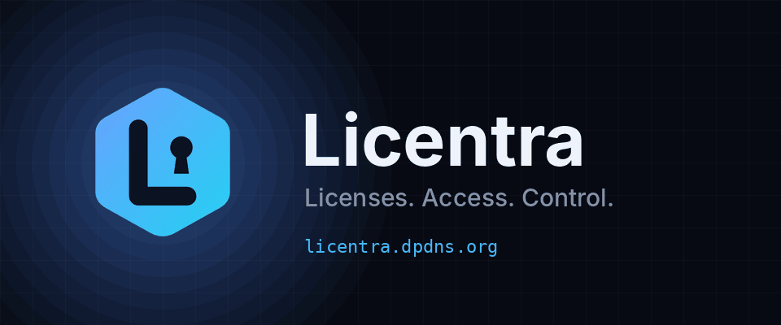
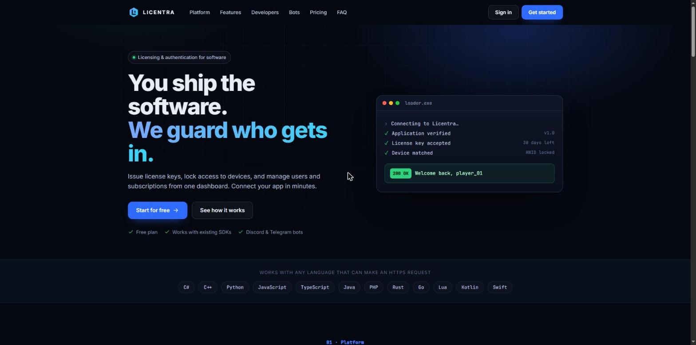
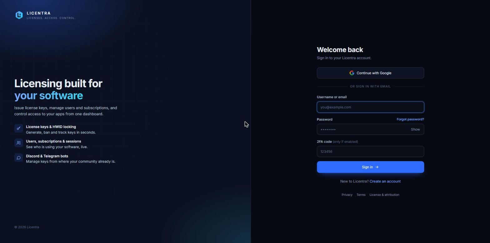
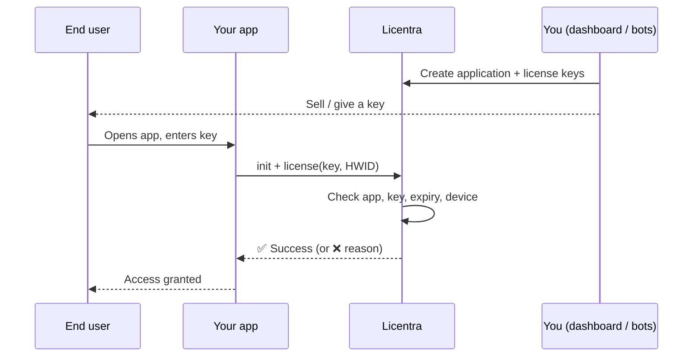
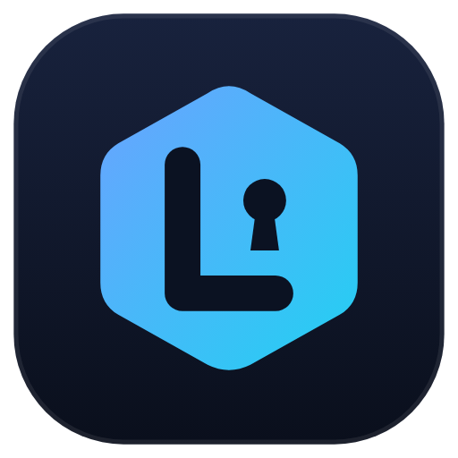

<div align="center">



<br>

**Licenses. Access. Control.**

Licensing and authentication for software — issue license keys, lock access to devices,<br>
and manage users and subscriptions from one dashboard.

<br>

[](https://licentra.dpdns.org)
[](https://discord.gg/s487amTud8)
[](https://t.me/LicentraAppBot)


</div>

---

> **Note:** This repository is an information page about Licentra. It does **not** contain the platform's source code.

## 📌 Contents

- [What is Licentra?](#-what-is-licentra)
- [Screenshots](#-screenshots)
- [Features](#-features)
- [How it works](#-how-it-works)
- [Getting started](#-getting-started)
- [Payments](#-payments)
- [Bots](#-discord--telegram-bots)
- [Security](#-security)
- [FAQ](#-faq)
- [Support](#-support)

## 🔷 What is Licentra?

Licentra is a hosted licensing service for software developers. You add a few lines of code to your app; when a user starts it, the app asks Licentra:

- Is this application genuine?
- Is this license key valid and not expired?
- Is it being used on the device it was locked to?

Licentra answers in milliseconds. You control everything — keys, users, subscriptions, bans — from a web dashboard, or from Discord and Telegram.

**Who is it for?** Developers selling tools, loaders, plugins, bots, game mods or any desktop / server software that needs paid access.

## 🖼 Screenshots

| Homepage | Sign in |
|:---:|:---:|
|  |  |

## ✨ Features

### 🔑 Licensing
- Generate license keys in bulk with custom masks, lengths and durations
- **HWID locking** — a key works only on the device it was first used on
- Ban, unban, extend, reset HWID or delete keys at any time
- Expiry tracking with clear "time left" display

### 👥 Users & subscriptions
- Users sign up inside your app with a license key
- Multiple subscription levels (e.g. Basic, Premium) per application
- Live sessions — see who is using your software right now
- Audit log of every important action

### 🧑‍💻 Developers
- Works with any language that can make an HTTPS request — C#, C++, Python, JavaScript, TypeScript, Java, PHP, Rust, Go, Lua, Kotlin, Swift and more
- Compatible with existing KeyAuth-style SDKs
- **Seller API** to automate key creation from your own shop or bot

### 🛒 Store & customers
- Built-in plans and checkout
- Prices shown in **₹ INR** (default), **$ USD** or **€ EUR**, auto-converted
- Order confirmation emails (order created → payment submitted → paid)
- Customers page for the owner: email, owned applications, orders and one-click actions

### 👑 Team & roles
- Owner, Admin and User roles
- Google sign-in, email sign-in, two-factor authentication (2FA)

## 🔄 How it works



## 🚀 Getting started

1. **Create an account** at [licentra.dpdns.org](https://licentra.dpdns.org/register/) (email or Google).
2. **Create an application** in the dashboard. You get an app name, owner ID and version.
3. **Add the SDK** for your language and paste those three values.
4. **Generate license keys** and give them to your customers.
5. **Ship your app.** Manage everything from the dashboard, Discord or Telegram.

A minimal example (Python-style pseudo code):

```python
app = Licentra(name="MyApp", owner_id="YOUR_OWNER_ID", version="1.0")
app.init()

if app.license(input("License key: ")):
    print("Welcome!", app.user.subscription, app.user.expiry)
else:
    print("Access denied:", app.message)
```

## 💳 Payments

| Method | How it is verified |
|---|---|
| **UPI** | Customer pays and submits the UTR / reference, owner approves |
| **Razorpay** (cards, UPI, netbanking) | Signed webhook, automatic |
| **Litecoin (LTC)** | Checked on-chain, 2 confirmations |
| **USDT — BEP20 (BNB Chain)** | Checked on-chain, 5 confirmations |
| **USDT — Polygon** | Checked on-chain, 20 confirmations |

Crypto is paid **directly to the owner's own wallet** — no third-party custody. Each order gets a unique amount so payments are matched automatically.

## 🤖 Discord & Telegram bots

Manage your licenses from where your community already is.

- **Discord bot** — slash commands **and** typed commands (with or without a prefix), custom per-server prefix (owner only), branded embeds and custom animated emojis
- **Telegram bot** — [@LicentraAppBot](https://t.me/LicentraAppBot) with the same core actions
- Create / delete / ban keys, view users, check application stats, and more

## 🛡 Security

- HTTPS everywhere with **HSTS**
- Strict **Content-Security-Policy**, Permissions-Policy and cross-origin isolation headers
- CSRF protection on every form, POST-redirect-GET pattern
- Signed (HMAC) payment webhooks
- Passwords hashed, optional **2FA**, Google OIDC sign-in
- Scanned with **OWASP ZAP** baseline — 0 failures
- Served behind Cloudflare

Found a security issue? Please report it privately on the [Discord server](https://discord.gg/s487amTud8) — don't open a public issue.

## ❓ FAQ

<details>
<summary><b>Is there a free plan?</b></summary>
Yes. You can start for free and upgrade when you need more.
</details>

<details>
<summary><b>Which programming languages are supported?</b></summary>
Any language that can make an HTTPS request. Ready-made examples exist for the most popular ones.
</details>

<details>
<summary><b>What happens if a key is shared?</b></summary>
With HWID locking enabled the key only works on the first device. You can reset or ban it from the dashboard or bots.
</details>

<details>
<summary><b>Where is the source code?</b></summary>
Licentra is a hosted service; its source is not published here.
</details>

## 💬 Support

- 🌐 Website — https://licentra.dpdns.org
- 💬 Discord — https://discord.gg/s487amTud8
- ✈️ Telegram — [@LicentraAppBot](https://t.me/LicentraAppBot)

<div align="center">
<br>

<br>
<sub>Licentra — Licenses. Access. Control.</sub>
</div>
